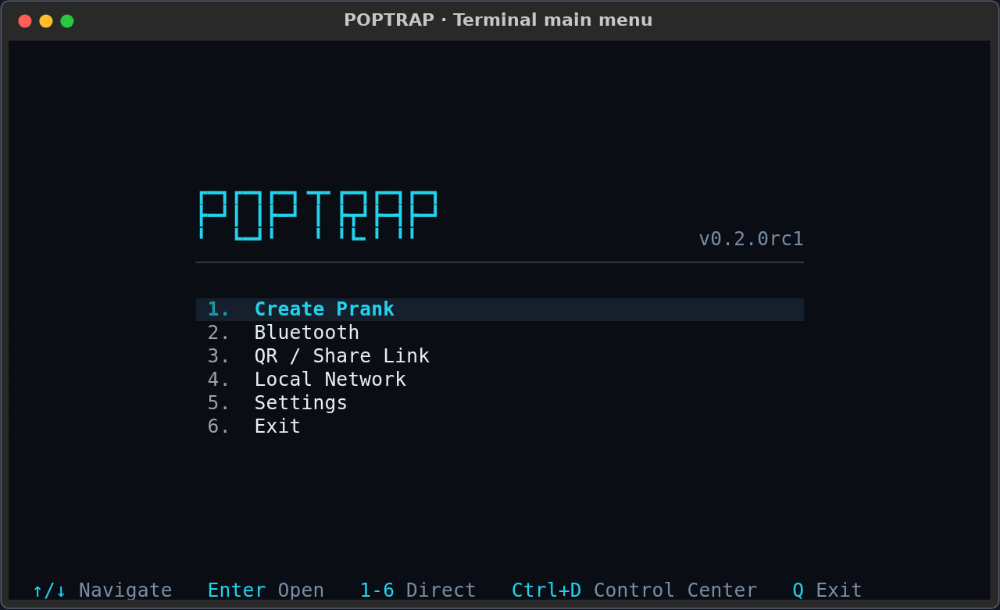

# POPTRAP

**Run consensual browser simulations from your terminal.** POPTRAP lets a creator compose a short visual experience, preview it, and offer it to someone on the same computer or a trusted local network. Recipients see a clear disclosure and choose **Launch Simulation** themselves. They can leave immediately with **Exit** or **Esc**.

**Current build: `0.2.0-rc.1`** (`0.2.0rc1` in Python packaging). This is an **unpublished release candidate** verified on Linux with Chromium, not a stable release or a public hosting service. See the [release notes](docs/release-notes/0.2.0-rc.1.md) and [compatibility matrix](docs/compatibility.md).



*Actual Textual rendering from the Linux test environment. See the [Control Center](docs/images/control-center.png) and [recipient consent screen](docs/images/recipient-consent.png) for genuine Chromium captures, including the pre-Launch screen in a 390 × 844 emulated viewport.*

## Quick start

Requires **Python 3.11+**, a real terminal (44 × 12 minimum; 80 × 24 recommended), and a browser. Python 3.11 on Linux is the verified release profile. From this source tree with a Python 3.11 virtual environment activated:

```bash
python -m pip install --require-hashes --only-binary=:all: -r requirements/runtime.lock
python -m poptrap --version
python -m poptrap --check
python -m poptrap --validate-config
python -m poptrap
```

For the release wheel, source archive, Windows/macOS commands, upgrade and uninstall, follow the [installation guide](docs/installation.md). No Node.js, browser driver, or Bluetooth hardware is required for ordinary local playback. First run reads bundled defaults; `poptrap --init-config` or **Settings → Save** creates the user configuration when you choose. A package uninstall leaves the user's presets and configuration in place.

## What you can do

| In the terminal | Workflow |
| --- | --- |
| **1. Create Prank** | Choose Glitch, Fake Virus Alert, Fake System Crash, Popup Storm, or Countdown. Review the local session, then open its consent page. Nothing scans files, alters device settings, or opens real pop-up windows. |
| **Prank Studio** | Customize the five templates, compose up to five stages, preview on the real player, and save reusable local presets. Obtain a fresh one-time link to use Browser Studio. |
| **2. Bluetooth** | Inspect actual host capabilities. Discover or pair only after explicit action and where the OS permits. An invitation receipt from a compatible peer is not acceptance or Launch. |
| **3. QR / Share Link** | Create a short-lived, single-use invitation. Review and **Accept** are separate from **Launch**. Copy it or display its QR, then revoke it if needed. |
| **4. Local Network** | Explicitly enable one assigned private IPv4 interface. Browsers opt in to availability before the creator can select them. No Wi-Fi device scan. |
| **Ctrl+D: Control Center** | Open the separate localhost creator workspace for sessions, delivery, devices, templates, presets, activity, diagnostics, and settings. Keep its access link private. |

See the [usage guide](docs/usage.md) for keyboard shortcuts, invitation flows, and stop/recovery steps.

## Safety and limits

POPTRAP starts with no public listener. Creator and local playback endpoints bind only to numeric loopback; opt-in delivery uses a separate recipient-only listener. **LAN HTTP is unencrypted.** Use trusted private networks only; do not proxy or port-forward POPTRAP. The browser simulates effects in its own tab with visible **SIMULATION** and Exit controls. Once launched, playback is bound to that document; reload, another tab, or back navigation cannot resume it.

No physical Bluetooth, camera, Wi-Fi or handset use was verified for this candidate. Firefox, WebKit, native Windows/macOS, and Termux are not certified by this release. See the [compatibility matrix](docs/compatibility.md), [privacy guide](docs/privacy.md), and [security policy](SECURITY.md).

## Documentation and development

- [Troubleshooting](docs/troubleshooting.md) · [Configuration reference](docs/configuration.md) · [Bluetooth details](docs/bluetooth.md)
- [Architecture](docs/architecture.md) · [Local runtime API](docs/runtime-api.md) · [Delivery protocol](docs/phase-6.md)
- [Phase 7: mobile](docs/phase-7.md) · [Phase 8: Control Center](docs/phase-8.md) · [Phase 9: hardening](docs/phase-9.md) · [Phase 10: release report](docs/phase-10.md)
- [Changelog](CHANGELOG.md) · [Build and verification](docs/releasing.md) · [Contributing](CONTRIBUTING.md) · [Code of conduct](CODE_OF_CONDUCT.md)

First-party code is [MIT](LICENSE). See [third-party notices](THIRD_PARTY_NOTICES.md) for the bundled Apache-2.0 QR decoder.
