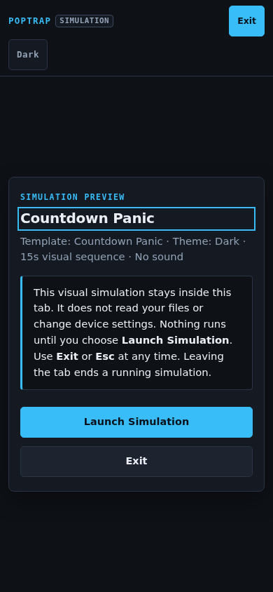
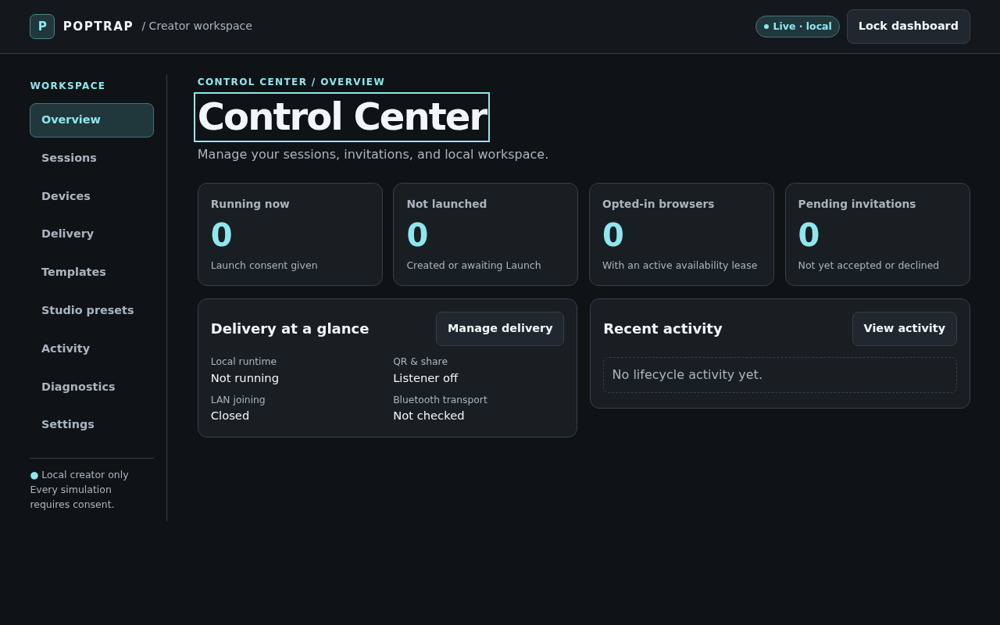

# Using POPTRAP

Use simulations with informed consent. Nothing should look like a real demand to perform a security action, log in, or disclose data. No playback starts until a recipient chooses **Launch Simulation**.

## Local session

1. Start `poptrap`, then press **1** for **Create Prank**. Choose **Quick Create** and select Glitch, Fake Virus Alert, Fake System Crash, Popup Storm, or Countdown.
2. Edit the title, duration, theme, and applicable settings. Audio is optional. Use **Preview** to review the configuration or **Start Session** to prepare a localhost player. Open the session URL on the same computer; it does not work on a different host.
3. The consent page shows a description and the Launch button. **Exit** or **Esc** is always the way out. While playing, the **SIMULATION** label remains visible and the effects are contained in the tab. Theme and mute controls are available where applicable.
4. Use the terminal's Stop action or **Ctrl+X** to end a local run. Losing the tab or connection stops playback; a reload or back navigation will not resume a run. Prepare a new session to start again.

*Actual consent screen in Chromium, with a 390 × 844 emulated viewport, before Launch.*

## Studio and presets

From **Create Prank**, open **Prank Studio** (`Ctrl+S`) or **Saved Presets** (`Ctrl+O`). Studio allows up to five stages (intro, effect, countdown, recovery and reveal) within a 120-second total. Use **Live Preview** (`Ctrl+P`) to prepare a local preview; review and launch it in the player. Use **Save Preset** to store validated local JSON. The library can load, rename, duplicate, and delete with confirmation; overwrites require explicit approval.

For the web editor, choose **New Browser Studio link** or use the creator dashboard. It is a 90-second, one-time link for the same machine. The plain `/studio` route is locked. Use a fresh link after reload, rotation or **Lock Studio**. Never use a creator link as an invitation.

## QR and LAN recipients

- **3. QR / Share Link:** Choose a template or preset and create a short-lived invitation. Share only the recipient link or its QR. The loopback address works only on the creator machine. Opening the link allows review; **Accept** opens a separate Launch screen. **Decline** ends the invitation. The creator can revoke an outstanding invitation or running playback.
- **4. Local Network:** Confirm one assigned private IPv4 interface on a trusted LAN and open joining. Each recipient opens the enrollment link and explicitly advertises availability. Select one or more eligible browsers and queue an invitation. No Wi-Fi device scanning or router client list is used. End joining or stop the listener to remove the corresponding access; stopping it invalidates all its grants.
- **QR scanner:** Use `/scan` on the active recipient listener for a local image or pasted link. Secure loopback camera capture is optional, requires an explicit action and browser permission, and is unavailable on the private LAN HTTP listener. Use your phone's normal camera or the image/paste workflow on LAN. See the [delivery](phase-6.md) and [mobile](phase-7.md) guides.

## Creator Control Center and Bluetooth

Press **Ctrl+D** to get a one-time **Control Center** link. Open it locally; do not share it. Views cover active and pending sessions, devices, delivery, templates, presets, activity, diagnostics and preferences. Stop or revoke an individual run, close a join window, and run due cleanup without discarding active sessions. **Lock dashboard** ends the authorizing grant. See the [Control Center guide](phase-8.md).

**2. Bluetooth** reports the host backend's actual capability. Only start discovery or pair an authorized device explicitly. The supported local backend and an appropriate receiving endpoint are required for native invitation transport. The ACK confirms transport only; it does not mean acceptance, remote control, or consent. See [Bluetooth limitations](bluetooth.md).

*Actual installed Control Center in Chromium on Linux; no access link is shown.*

## Keyboard essentials

| Key | Action |
| --- | --- |
| `↑` / `↓`, `Enter`, `1`–`6` | Navigate or open a main-menu item |
| `Tab`, `Shift+Tab`, `Space` | Navigate and operate focused controls |
| `Ctrl+D` | Creator Control Center or fresh dashboard link |
| `Ctrl+P`, `Ctrl+R`, `Ctrl+X` | Preview, prepare, or stop in the relevant creation screen |
| `Esc` | Back in terminal; Exit during browser playback |
| `Ctrl+Q` / `Ctrl+C` | Close POPTRAP and stop its listeners |

[Install](installation.md) · [Troubleshoot](troubleshooting.md) · [Privacy](privacy.md)
